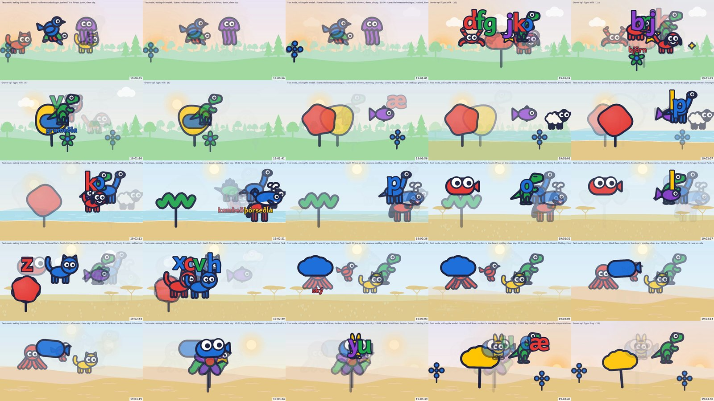
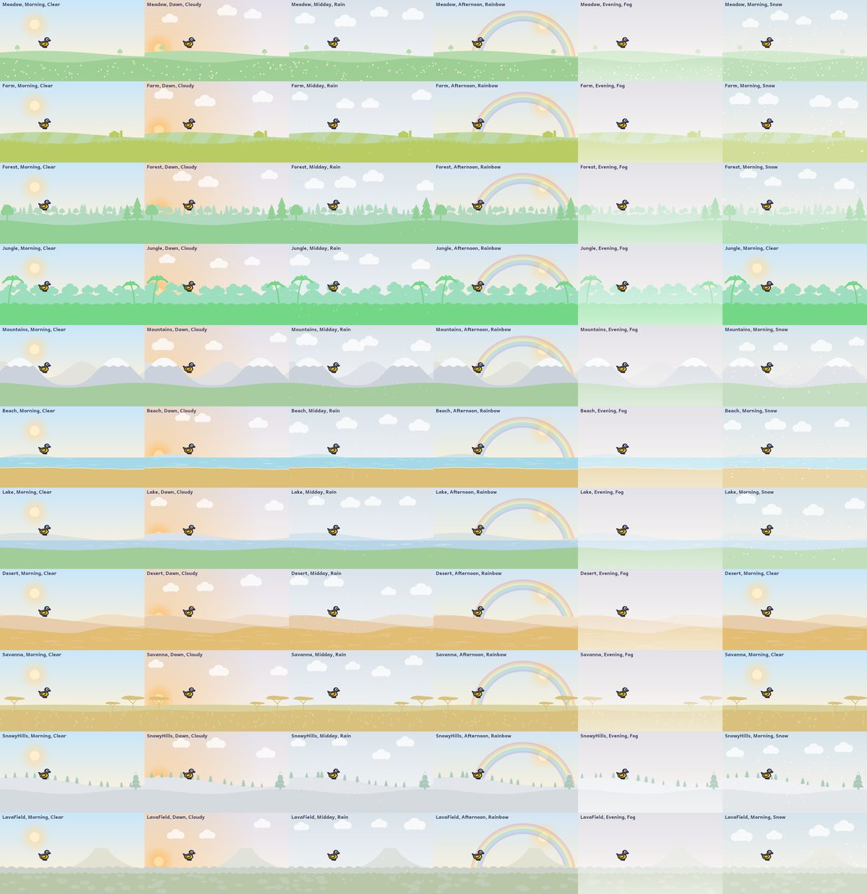

# Keypuncher

A keyboard-and-touchscreen toy for an infant, built around a small LLM running locally on the family PC.

Every key a baby bangs answers at once with a shape and a note. Letters are shown and said by their sound,
in Icelandic, English or Bulgarian. Over many sessions, a local model slowly turns the toy's invented
shapes into real animals, extinct animals, plants and vehicles, moves the landscape between real places,
seasons and weather, and fetches real photographs that the toy cuts out and introduces step by step. The
world is saved, so the screen a child returns to tomorrow is the one they left today.



*Twenty-five moments from five minutes of one play session, in test mode. The model moves the scene from a forest in
Iceland to Bondi Beach, the Kruger and Wadi Rum, and turns key families into a red cabbage, a sable,
a pterodactyl, a plesiosaur and an oak.*

## Why it is interesting

- **A local LLM that is only allowed to say true things.** The model (qwen3:4b in Ollama, on a 6 GB
  GTX 1060) never writes words the child sees or hears. It picks real things for the world, and every
  pick passes three layers: a JSON schema that constrains the category and shape, rules in code
  (no dragons or unicorns, no snow in the Sahara, no shark in a lake, no repeats), and a second, cold
  fact-check call that has to agree independently. A reliability bench across eight models and several
  prompt variants chose the prompts and the model; its results live in [`bench-results/`](bench-results).
- **Hard real-time on the input path.** A key press is answered in the same frame. No model, file or
  network work runs on that path; the model works in a background loop every half minute to few minutes,
  and play never waits for it.
- **A picture pipeline with no human in the loop.** For each real thing, the toy finds a photo
  (Wikipedia, Wikidata, iNaturalist; maps, skeletons, drawings and logos are turned down), cuts the subject
  out on the CPU with an ONNX background-removal model, records the photographer and licence, and shows
  credits on the grown-ups' page. Gaps are drawn overnight by a local image model (Z-Image-Turbo), and a
  vision model (gemma3) checks every picture, with the pass decided in code rather than by the model's
  own yes or no.
- **Designed for a baby's eyes.** Calm levels (Baby, Toddler, Big toddler) set how many things move and
  how they are drawn: thick dark outlines, few saturated colours and large bodies for the youngest, held
  by tests that also fail any patch of screen that flashes more than three times a second. Photos are
  introduced over separate plays, shape to silhouette to flat colours to photo.
- **Locked down for a child, easy for a grown-up.** A low-level keyboard hook keeps Win, Alt+Tab and
  friends from Windows during play. Grown-ups get out with a key chord or a held key and a typed word,
  or on a touch screen with a two-corner hold and a sequence a child cannot copy.

## Tech

C# on .NET 10, .NET MAUI (WinUI 3) for the Windows app, SkiaSharp for all drawing, NAudio and
WASAPI for a small synth and mixer with a volume cap and limiter, SQLite for the world, OllamaSharp
for the model, ONNX Runtime for picture cut-outs, stable-diffusion.cpp for image generation, and xUnit
(400+ tests; everything except the Windows-specific pieces also runs on Linux). Warnings are errors.

| Project | What it does |
| --- | --- |
| `src/Keypuncher.App` | The MAUI app: play page, grown-ups' page, voice recording page |
| `src/Keypuncher.Toy` | The reflex loop: what every key, mash and tap does, speech lookup, grown-up exit |
| `src/Keypuncher.Core` | World model, recipes, input, keyboard geometry, calm levels, art style |
| `src/Keypuncher.Director` | The model's jobs: prompts, schemas, real-thing and scene rules, fact and place checkers |
| `src/Keypuncher.Pictures` | Photo finding, cut-out, picture checks, generation for gaps |
| `src/Keypuncher.Rendering` | SkiaSharp scenes and shapes |
| `src/Keypuncher.Audio` | Synth, mixer, limiter, WAV files |
| `src/Keypuncher.Language` | Icelandic alphabet, Bulgarian phonetic key map, words |
| `src/Keypuncher.Storage` | The world in SQLite, recordings, settings |
| `src/Keypuncher.Platform.Windows` | Keyboard hook, audio output, microphone, Windows voices |
| `src/Keypuncher.Inference*` | Model interfaces and the Ollama implementation |
| `tools/` | Headless preview renderer, model benches, picture pipeline CLI |
| `tests/` | xUnit tests |



*Eleven landscapes in each kind of weather, rendered without a window by `tools/Keypuncher.Preview`.*

## Running it

Needs Windows, the .NET 10 SDK with the MAUI workload, and optionally [Ollama](https://ollama.com).

```powershell
dotnet workload install maui-windows
dotnet test
ollama pull qwen3:4b                      # optional: without it the toy plays, but the world doesn't change
dotnet run --project src/Keypuncher.App
```

The toy covers the screen. Press **Ctrl+Shift+Q** and type the word shown to reach the grown-ups'
page, where you can quit.

To see it without Windows: `dotnet run --project tools/Keypuncher.Preview -- --out preview --keys "sól 3 köttur"`
writes PNG frames and a WAV of a scripted session.

The full guide, covering every feature, setting, tool and the bench's findings, is in
[`docs/guide.md`](docs/guide.md).

## How it was built

A family project, made for one child and two keyboards in an Icelandic-speaking home. I set the goals,
made the design calls and tested every change on the real hardware with the real user; much of the code
was written with [Claude Code](https://claude.com/claude-code) as a pair programmer, which is why many
commits are co-authored. The pull request history records each step, what was measured, and why.

## Licence

The code is under the [MIT licence](LICENSE). The bundled Andika font is © SIL International under the
[SIL Open Font License](src/Keypuncher.Rendering/Fonts/OFL.txt). Photos the toy fetches at run time keep
their own licences, which it records beside each picture and shows on the grown-ups' page. The cut-out
models (ISNet, BiRefNet) and image model (Z-Image-Turbo) are downloaded separately and are not part of
this repository.
